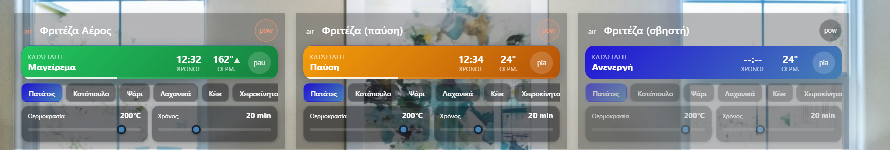

# Air Fryer Card

Συμπαγής κάρτα «σκούρο γυαλί» για **φριτέζα αέρος** στο Home Assistant: κατάσταση που αλλάζει χρώμα (σβηστή / παύση / μαγείρεμα), **ζωντανή αντίστροφη μέτρηση** με μπάρα προόδου, θερμοκρασία με ένδειξη ανόδου, προγράμματα και μπάρες για θερμοκρασία και χρόνο.

*Compact glass card for an air fryer: status colours, live countdown with progress, programs, target temperature and time. Full visual editor.*



## Εγκατάσταση
**HACS:** ⋮ → Custom repositories → `https://github.com/stathisktm/air-fryer-card`, τύπος **Dashboard** → Download.
**Χειροκίνητα:** αντέγραψε το `air-fryer-card.js` στο `/config/www/` και πρόσθεσε πόρο `/local/air-fryer-card.js` (JavaScript module).

## Ρύθμιση
Από τον **οπτικό editor** της κάρτας (επιλογή οντοτήτων από λίστα, όρια, χρώματα) ή σε YAML:
```yaml
type: custom:air-fryer-card
title: Φριτέζα Αέρος
entity_power: switch.air_fryer_power
entity_play: switch.air_fryer_play
entity_status: sensor.air_fryer_status
entity_time_remaining: sensor.air_fryer_time_remaining
entity_current_temp: sensor.air_fryer_current_temp
entity_program: select.air_fryer_programma
entity_target_temp: number.air_fryer_target_temp
entity_target_time: number.air_fryer_target_time
```
Προαιρετικά: `temp_min/max/step`, `time_min/max/step`, και χρώματα `color_off`, `color_on_pause`, `color_on_play`, `color_program`, `color_slider`, `color_play` (χρώμα ή CSS gradient).

Ο χρόνος που απομένει μπορεί να είναι `HH:MM:SS`, `MM:SS` ή αριθμός. Η μονάδα (s / min / h) διαβάζεται από τον αισθητήρα.

## Αλλαγές
- **2.0.0:** οπτικός editor, ζωντανή αντίστροφη μέτρηση και μπάρα προόδου, ένδειξη ανόδου θερμοκρασίας, χωρίς τρεμόπαιγμα στα προγράμματα, οι μπάρες δεν «πηδάνε» όσο τις σέρνεις, αυτόματη εύρεση οντοτήτων, πάτημα στον τίτλο για λεπτομέρειες. Η αρχική έκδοση υπάρχει στο πρώτο commit.

## Άδεια
[MIT](LICENSE)
